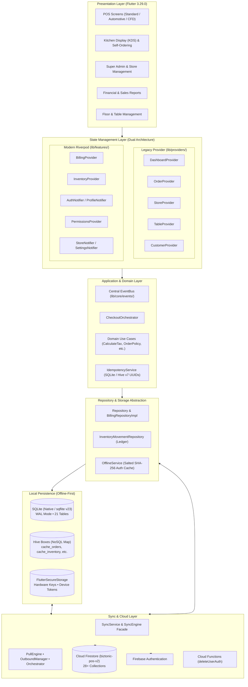
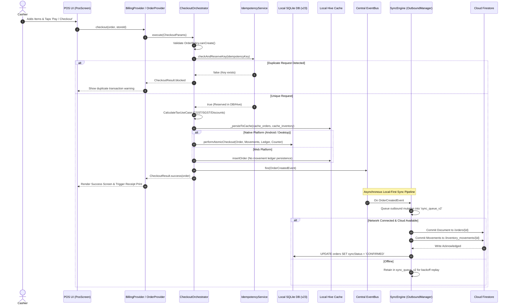

# BizPOS-Clone: Architectural Baseline Audit

**Repository**: `https://github.com/Biztonic/BizPOS-Clone.git`  
**Audit Timestamp**: 2026-09-18T23:15:00+05:30  
**Environment**: Flutter 3.29.0 (Channel stable) • Dart 3.7.0 • Firebase Backend `biztonic-pos-v2`  
**Document Purpose**: Definitive technical baseline mapping all 18 functional systems, data models, schemas, write boundaries, security paths, and operational risks prior to further architectural refactoring.

---

## 1. System Architecture Diagram

BizPOS currently operates in a **hybrid transition state** between a legacy MVC/Provider monolithic architecture and a Clean Architecture (DDD/Riverpod/Use Cases) layer.



---

## 2. End-to-End Data Flow Diagram



---

## 3. Mapping of the 18 Application Subsystems

| # | System Subsystem | Primary Code Location | Implementation Pattern | Status & Health |
| :--- | :--- | :--- | :--- | :--- |
| **1** | **Presentation** | `lib/screens/`, `lib/core/design/` | Material Design 3, multi-flavor (Retail, Restaurant, Automotive, CFD, KDS), responsive layout | Active, 241 styling and deprecation lints (`withOpacity`). |
| **2** | **State Management** | `lib/providers/`, `lib/features/**/providers/` | **Dual architecture**: ChangeNotifier Provider alongside Riverpod 2.6 Notifiers | **High maintenance risk**: parallel state models co-exist. |
| **3** | **Domain Layer** | `lib/features/**/domain/` | Pure Dart entities, Value Objects, and Policies (`OrderPolicy`, `CalculateTax`) | Robust domain rules, well tested in unit suites. |
| **4** | **Application / Use Cases** | `lib/features/**/application/` | `CheckoutOrchestrator`, `InventoryOrchestrator`, Use Case command pattern | Clean isolation for checkout and tax logic. |
| **5** | **Repository / Data Layer** | `lib/services/repository.dart`, `lib/features/**/data/` | Repositories with platform branching (`kIsWeb` vs Native) | Highly coupled to both SQLite and Hive simultaneously. |
| **6** | **SQLite Database** | `lib/services/database_helper.dart` | `sqflite` (Native) / `sqflite_common_ffi_web` (Wasm Shim), Schema v23, WAL mode | 21 production tables with cascading constraints & indexing. |
| **7** | **Hive Storage** | `lib/bootstrap/hive_bootstrap.dart`, `lib/sync/registry/` | `hive_flutter 1.1.0`, AES-256 encryption support for sensitive stores | 18+ active boxes utilized for caches, queues, and settings. |
| **8** | **Cloud Firestore** | `firestore.rules`, `lib/services/firestore_helper.dart` | Document/Collection NoSQL model under project `biztonic-pos-v2` | Multi-store root collections with subcollection legacy paths. |
| **9** | **Authentication** | `lib/features/auth/`, `lib/services/offline_service.dart` | Firebase Auth (online), Salted SHA-256 password cache (offline), Lockout | Hardened: Zero raw passwords cached. |
| **10** | **Synchronization** | `lib/sync/sync_engine.dart` (and submodules) | Decomposed Orchestrator, PullEngine, OutboundManager, Adapters, SyncRegistry | Asynchronous, non-blocking, exponential retry backoff. |
| **11** | **Subscription Enforcement**| `lib/sync/limits/`, `lib/sync/policy/`, `FeatureGuard` | Starting, Basic, Standard, Enterprise tier policies + HMAC Plan Tokens | Multi-level enforcement in UI and sync pipeline. |
| **12** | **Inventory Management** | `lib/features/inventory/`, `InventoryMovementRepository` | Event-sourced ledger (`inventory_movements`) + derived quantity cache | Automated reconciliation routine (`reconcileInventoryStock`). |
| **13** | **Billing & Checkout** | `lib/features/billing/`, `lib/providers/order_provider.dart` | `CheckoutOrchestrator`, domain tax snapshots, idempotency reservation | End-to-end atomic on Native; partial persistence on Web. |
| **14** | **Employee / PIN Login** | `lib/widgets/employee_pin_dialog.dart`, `EmployeeRepository` | Short code lookup, Local-first cache verification, SHA-256 + UID salt | Anonymous auth fallback risk present. |
| **15** | **Reporting System** | `lib/screens/reports/`, `lib/features/reporting/` | In-memory aggregations (Web) & SQL aggregations (Native) | Contains arbitrary 70% COGS fallback for empty item records. |
| **16** | **Backup & Recovery** | `lib/services/recovery_service.dart`, `GoogleDriveService` | Transaction journal crash recovery + Google Drive JSON export | Journal scans for pending transactions on boot. |
| **17** | **Hardware & Printing** | `packages/flutter_thermal_printer/`, `PrinterManagerService` | USB Serial, Bluetooth Low Energy (BLE), Network ESC/POS, Background keepalive | Cross-platform with web stubs; persistent keepalive loop. |
| **18** | **CI / CD Pipeline** | `.github/workflows/` (`flutter_ci.yml`, `build_release_apk.yml`) | GitHub Actions on Ubuntu runner, Flutter 3.29.0, JDK 17 | CI is fail-fast; release APK workflow generates ephemeral keys. |

---

## 4. Cloud Firestore Collection Structure

Root Firebase Project: `biztonic-pos-v2` (configured via `firebase.json` and `firestore.rules`).

| Collection Path | Scope | Schema Description & Core Fields | Firestore Security Status |
| :--- | :--- | :--- | :--- |
| `/users/{uid}` | User Profiles | `email`, `role`, `name`, `storeId`, `accessibleStoreIds`, `needsInitialPassword` | Auth required. **Vulnerability**: Unauthenticated read if `needsInitialPassword == true`. |
| `/stores/{storeId}` | Multi-Tenant Stores | `name`, `owner`, `ownerEmail`, `currency`, `shortCode`, `status`, `plan` | Read restricted to store members/owner; Write restricted to owner/Super Admin. |
| `/stores/{storeId}/employees/{id}` | Store Employees | Subcollection: `name`, `employeeId`, `pinHash`, `role`, `permissions` | Inherits store access rule (`storeAccess(storeId)`). |
| `/stores/{storeId}/subscription_history/{id}` | Store Billing | Subcollection: `planId`, `amount`, `startDate`, `endDate`, `status` | Read for store; Write restricted to Super Admin. |
| `/orders/{orderId}` | Transactions | Root collection: `storeId`, `total`, `subtotal`, `cgst`, `sgst`, `date`, `status`, `items[]` | Filtered by `storeId`. Delete forbidden except by Super Admin. |
| `/inventory/{itemId}` | Product Catalog | `storeId`, `name`, `price`, `cost`, `sku`, `quantity`, `category`, `isDeleted` | Filtered by `storeId`. Delete allowed for store owner. |
| `/inventory_movements/{id}` | Stock Ledger | `storeId`, `itemId`, `delta`, `type`, `orderId`, `reason`, `createdAt` | Append-only ledger. Delete forbidden except by Super Admin. |
| `/customers/{id}` | CRM | `storeId`, `name`, `phone`, `email`, `loyaltyPoints`, `totalSpent` | Filtered by `storeId`. Full store access. |
| `/floors/{id}` & `/tables/{id}` | Dine-in Layout | `storeId`, `data` (JSON blob containing geometry, name, status) | Filtered by `storeId`. Full store access. |
| `/suppliers/{id}` & `/notes/{id}` | Operations | `storeId`, `data` (JSON blob) | Filtered by `storeId`. Full store access. |
| `/business_events/{id}` | Financial Audit | `storeId`, `entityType`, `entityId`, `eventType`, `amount`, `quantity` | Append-only event store. Delete forbidden except by Super Admin. |
| `/activity_logs/{id}` | Security Audit | `storeId`, `action`, `actorId`, `timestamp`, `details` | Append-only audit. Delete forbidden except by Super Admin. |
| `/counters/{id}` | Invoice Sequence | `storeId`, `counterType`, `currentNumber`, `prefix` | Atomic counter increments. |
| `/subscription_requests/{id}` | Invoicing / Plan | `storeId`, `ownerEmail`, `requestedPlan`, `paymentRef`, `status: PENDING` | **Vulnerability**: Unauthenticated read if `status == 'PENDING'`. Non-admins can only create PENDING. |
| `/roles/{roleId}` | RBAC Templates | `name`, `permissions[]`, `isSystem`, `description` | Authenticated read; Write restricted to Super Admin. |
| `/leads/{leadId}` | Public Inquiries | `name`, `email`, `phone`, `notes`, `createdAt` | **Vulnerability**: Public unauthenticated create allowed (`allow create: if true;`). |
| `/settings/{storeId}` | Store Configurations| `storeId`, `taxSettings`, `printerSettings`, `kdsConfig`, `features` | Store members have read/write access. |
| `/settings/admin_config` | Global App Config | `supportedVersions`, `maintenanceMode`, `featureFlags` | Read authenticated; Write restricted to Super Admin. |
| `/settings/platform_limits` | Tier Limitations | `limits` (order ceilings, storage limits, sync frequencies) | Read authenticated; Write restricted to Super Admin. |

---

## 5. SQLite Database Schema (DatabaseHelper v23)

Database partition: `biztonic_${uid}.db` (or `biztonic.db`).  
WAL Mode: Enabled (`PRAGMA journal_mode = WAL`).  
Foreign Keys: Enabled (`PRAGMA foreign_keys = ON`).

```sql
-- 1. ORDERS
CREATE TABLE orders (
  id TEXT PRIMARY KEY,
  storeId TEXT,
  total REAL,
  discount REAL,
  date TEXT,
  status TEXT,
  type TEXT,
  paymentMethod TEXT,
  customerName TEXT,
  customerPhone TEXT,
  tableId TEXT,
  tableName TEXT,
  synced INTEGER DEFAULT 0,
  updatedAt TEXT,
  deletedAt TEXT,
  syncStatus TEXT DEFAULT 'PENDING',
  deviceId TEXT,
  lastSyncedAt TEXT,
  version INTEGER DEFAULT 1,
  isDeleted INTEGER DEFAULT 0,
  businessDayId TEXT,
  taxRateSnapshot REAL DEFAULT 0.0,
  discountSnapshot REAL DEFAULT 0.0,
  subtotal REAL DEFAULT 0.0,
  cgst REAL DEFAULT 0.0,
  sgst REAL DEFAULT 0.0,
  voidedAt TEXT,
  voidedBy TEXT,
  voidReason TEXT
);

-- 2. ORDER ITEMS (Cascading delete from orders)
CREATE TABLE order_items (
  id INTEGER PRIMARY KEY AUTOINCREMENT,
  orderId TEXT,
  itemId TEXT,
  name TEXT,
  price REAL,
  quantity INTEGER,
  note TEXT,
  seatIndex INTEGER,
  category TEXT,
  cost REAL,
  cgst REAL DEFAULT 0.0,
  sgst REAL DEFAULT 0.0,
  FOREIGN KEY(orderId) REFERENCES orders(id) ON DELETE CASCADE
);

-- 3. INVENTORY & PRODUCTS
CREATE TABLE inventory (
  id TEXT PRIMARY KEY,
  storeId TEXT,
  name TEXT,
  category TEXT,
  price REAL,
  quantity INTEGER,
  status TEXT,
  image TEXT,
  sku TEXT,
  cost REAL,
  unit TEXT,
  expiryDate TEXT,
  trackStock INTEGER,
  centralItemId TEXT,
  storeType TEXT,
  dietaryType TEXT,
  packagingType TEXT,
  variantCategory TEXT,
  featured INTEGER DEFAULT 0,
  updatedAt TEXT,
  deletedAt TEXT,
  syncStatus TEXT DEFAULT 'PENDING',
  deviceId TEXT,
  lastSyncedAt TEXT,
  version INTEGER DEFAULT 1,
  isDeleted INTEGER DEFAULT 0,
  lowStockThreshold INTEGER DEFAULT 10,
  localImage TEXT
);

-- 4. INVENTORY MOVEMENTS (Append-Only Event Ledger)
CREATE TABLE inventory_movements (
  id TEXT PRIMARY KEY,
  itemId TEXT NOT NULL,
  storeId TEXT NOT NULL,
  type TEXT NOT NULL,
  delta INTEGER NOT NULL,
  orderId TEXT,
  reason TEXT,
  referenceNumber TEXT,
  cost REAL,
  deviceId TEXT,
  createdAt TEXT NOT NULL,
  syncStatus TEXT DEFAULT 'PENDING',
  syncedAt TEXT,
  isDeleted INTEGER DEFAULT 0,
  FOREIGN KEY(itemId) REFERENCES inventory(id) ON DELETE CASCADE
);

-- 5. CACHE INVENTORY QUANTITIES (Ephemeral Materialized View)
CREATE TABLE cache_inventory_quantities (
  itemId TEXT PRIMARY KEY,
  storeId TEXT,
  quantity INTEGER DEFAULT 0
);

-- 6. CUSTOMERS
CREATE TABLE customers (
  id TEXT PRIMARY KEY,
  storeId TEXT,
  name TEXT,
  email TEXT,
  mobile TEXT,
  phone TEXT,
  whatsapp TEXT,
  taxNumber TEXT,
  billingAddress TEXT,
  shippingAddress TEXT,
  avatar TEXT,
  joinDate TEXT,
  totalSpent REAL,
  loyaltyPoints INTEGER,
  tier TEXT,
  visitCount INTEGER,
  lastVisit TEXT,
  updatedAt TEXT,
  deletedAt TEXT,
  syncStatus TEXT DEFAULT 'PENDING',
  deviceId TEXT,
  lastSyncedAt TEXT,
  version INTEGER DEFAULT 1,
  isDeleted INTEGER DEFAULT 0
);

-- 7. EMPLOYEES & HR
CREATE TABLE employees (
  id TEXT PRIMARY KEY,
  storeId TEXT,
  name TEXT,
  email TEXT,
  role TEXT,
  employeeId TEXT,
  pinHash TEXT,
  permissions TEXT,
  hourlyRate REAL DEFAULT 0.0,
  monthlySalary REAL DEFAULT 0.0,
  createdAt TEXT,
  updatedAt TEXT,
  deletedAt TEXT,
  syncStatus TEXT DEFAULT 'PENDING',
  deviceId TEXT,
  lastSyncedAt TEXT,
  version INTEGER DEFAULT 1,
  isDeleted INTEGER DEFAULT 0
);

CREATE TABLE employee_attendance (
  id TEXT PRIMARY KEY,
  employeeId TEXT NOT NULL,
  storeId TEXT NOT NULL,
  checkIn TEXT NOT NULL,
  checkOut TEXT,
  location TEXT,
  syncStatus TEXT DEFAULT 'PENDING',
  updatedAt TEXT,
  FOREIGN KEY(employeeId) REFERENCES employees(id) ON DELETE CASCADE
);

CREATE TABLE employee_leaves (
  id TEXT PRIMARY KEY,
  employeeId TEXT NOT NULL,
  storeId TEXT NOT NULL,
  startDate TEXT NOT NULL,
  endDate TEXT NOT NULL,
  type TEXT NOT NULL,
  reason TEXT,
  status TEXT DEFAULT 'PENDING',
  syncStatus TEXT DEFAULT 'PENDING',
  updatedAt TEXT,
  FOREIGN KEY(employeeId) REFERENCES employees(id) ON DELETE CASCADE
);

CREATE TABLE employee_payroll (
  id TEXT PRIMARY KEY,
  employeeId TEXT NOT NULL,
  storeId TEXT NOT NULL,
  periodStart TEXT NOT NULL,
  periodEnd TEXT NOT NULL,
  baseAmount REAL DEFAULT 0.0,
  bonus REAL DEFAULT 0.0,
  deductions REAL DEFAULT 0.0,
  totalAmount REAL DEFAULT 0.0,
  status TEXT DEFAULT 'PENDING',
  syncStatus TEXT DEFAULT 'PENDING',
  updatedAt TEXT,
  FOREIGN KEY(employeeId) REFERENCES employees(id) ON DELETE CASCADE
);

-- 8. ROLES
CREATE TABLE roles (
  id TEXT PRIMARY KEY,
  storeId TEXT,
  name TEXT,
  permissions TEXT,
  isSystem INTEGER DEFAULT 0,
  description TEXT,
  storeAccessMode TEXT DEFAULT 'single',
  createdAt TEXT,
  updatedAt TEXT,
  deletedAt TEXT,
  syncStatus TEXT DEFAULT 'PENDING',
  lastSyncedAt TEXT
);

-- 9. BUSINESS LEDGER & TOKENS
CREATE TABLE business_events (
  id TEXT PRIMARY KEY,
  storeId TEXT,
  entityType TEXT,
  entityId TEXT,
  eventType TEXT,
  amount REAL,
  quantity INTEGER,
  createdAt TEXT,
  deviceId TEXT,
  synced INTEGER DEFAULT 0,
  syncedAt TEXT
);

CREATE TABLE monthly_order_counter (
  storeId TEXT,
  yearMonth TEXT,
  count INTEGER,
  PRIMARY KEY (storeId, yearMonth)
);

CREATE TABLE plan_tokens (
  storeId TEXT PRIMARY KEY,
  token TEXT,
  signature TEXT,
  validUntil TEXT
);

-- 10. CONFIGURATION ENTITIES (JSON Blobs)
-- Tables: floors, tables, suppliers, notes, store_settings
-- Schema for each:
-- (id TEXT PRIMARY KEY, storeId TEXT, data TEXT, syncStatus TEXT, updatedAt TEXT, deletedAt TEXT, version INTEGER, isDeleted INTEGER, lastSyncedAt TEXT)

-- 11. IDEMPOTENCY & TRANSACTION JOURNAL (Tier 1 Hardening)
CREATE TABLE idempotency_keys (
  key TEXT PRIMARY KEY,
  entityType TEXT,
  entityId TEXT,
  deviceId TEXT,
  createdAt TEXT
);

CREATE TABLE transaction_journal (
  id TEXT PRIMARY KEY,
  storeId TEXT,
  status TEXT, -- 'PENDING', 'COMPLETED', 'FAILED'
  operations TEXT, -- Full JSON payload for rollback/replay
  createdAt TEXT,
  completedAt TEXT,
  error TEXT
);
```

---

## 6. Hive Box Registry & Purpose

| Box Name | Encryption | Purpose & Payload | Key Lifecycle / Expiration |
| :--- | :--- | :--- | :--- |
| `cache_orders` | Plain | Local order cache for offline POS lookup | Persistent across sessions |
| `cache_inventory` | Plain | Product catalog cache with in-memory quantity | Synced from Firestore / SQLite |
| `cache_customers` | Plain | Customer profile cache for phone lookup | Synced from Firestore |
| `cache_stores` | Plain | User accessible store records | Refreshed on authentication |
| `cache_employees` | Plain | Employee PIN and role definitions | Refreshed on store selection |
| `cache_floors` / `cache_tables` | Plain | Dine-in room and table layouts | Store-partitioned |
| `cache_suppliers` / `cache_notes`| Plain | Vendor contacts and quick order notes | Store-partitioned |
| `settings` | Plain | Device-specific preferences, UI dark mode, IP | Device lifecycle |
| `sync_queue_v2` | Plain | Outbound offline mutation FIFO queue | Cleared upon successful Firestore write |
| `sync_failed_queue_v2` | Plain | Dead-letter queue for mutations exceeding max retries | Retained for admin diagnosis |
| `sync_logs` | Plain | Audit history of sync runs and error details | 7-day circular buffer |
| `auth_cache` | Plain / Hash | Salted SHA-256 user hashes, salts, and attempt counters | Purged on explicit logout |
| `idempotency_keys` | Plain | Web platform idempotency reservations | 24-hour TTL expiration check |
| `marketing_audio` | Plain | Synthesized and recorded promotional voice promos | Persistent cache |
| `error_logs` | Plain | Uncaught Flutter exceptions and diagnostic telemetry | Synced to Crashlytics |

---

## 7. Synchronization Pipeline

The sync architecture is centered around `SyncService` which coordinates 5 dedicated engines:

1. **Inbound Pull (`PullEngine`)**:
   - Queries collections (`orders`, `inventory`, `customers`, etc.) filtered by `storeId`.
   - Uses `lastSyncedAt` cursor timestamps to fetch only delta records (`updatedAt > lastSyncedAt`).
   - Throttled by `PlanSyncPolicy` based on store plan (Starting: manual only; Basic: 1/day; Standard/Enterprise: Real-time / 5-min).
2. **Outbound Push (`OutboundManager`)**:
   - Monitors `sync_queue_v2` for pending mutations generated offline.
   - Converts local records into Firestore documents via typed `SyncAdapter` implementations (`OrdersSyncAdapter`, `InventorySyncAdapter`, etc.).
   - Uses exponential backoff (2s, 4s, 8s, up to 60s) upon network failure.
   - Moves poisoned/rejected mutations to `sync_failed_queue_v2` after 5 failed attempts.
3. **Conflict Resolution (`ConflictResolver`)**:
   - Implements **Server-Wins with Local Vector Versioning**: If remote document `version >= local.version`, remote overwrites local; otherwise local push proceeds.
   - Financial ledger (`inventory_movements` and `business_events`) is **strictly append-only** and never overwritten.
4. **Maintenance (`SyncMaintenanceEngine`)**:
   - Periodically purges confirmed soft-deleted records (`isDeleted == 1 AND syncStatus == 'CONFIRMED'`) older than 30 days.

---

## 8. Authentication & Authorization Flows

```mermaid
flowchart TD
    Start([User Initiates Login]) --> NetCheck{Network Available?}

    subgraph Online_Path ["Online Authentication"]
        NetCheck -->|Yes| FA[Firebase Auth: signInWithEmailAndPassword]
        FA -->|Success| ProfileFetch[Fetch Firestore /users/uid]
        ProfileFetch --> CacheCreds[OfflineService: Compute Salt & SHA-256 Hash]
        CacheCreds --> WriteHash[(Store Salt & Hash in auth_cache)]
        WriteHash --> RoleCheck{Role Evaluation}
    end

    subgraph Offline_Path ["Offline-First Authentication"]
        NetCheck -->|No| HashLookup[Retrieve Salt & Hash from auth_cache]
        HashLookup --> AttemptCheck{Failed Attempts >= 5?}
        AttemptCheck -->|Yes| Lockout[Account Locked Out: Require Cloud Login]
        AttemptCheck -->|No| HashVerify{SHA256(password + salt) == storedHash}
        HashVerify -->|Match| ResetCounter[Reset Failed Counter]
        ResetCounter --> LocalProfile[Load Cached User Profile from Hive]
        LocalProfile --> RoleCheck
        HashVerify -->|Mismatch| IncCounter[Increment Failed Counter]
        IncCounter --> Reject[Invalid Credentials]
    end

    RoleCheck -->|Super Admin| AdminApp([Full System Access])
    RoleCheck -->|Store Owner / Cashier| StoreCheck{Active Store Assigned?}
    StoreCheck -->|Yes| POSApp([POS Dashboard])
    StoreCheck -->|No| StoreSelect([Store Selection Screen])
```

---

## 9. Known Duplicate Implementations & Technical Debt

1. **Dual Entity Architecture**:
   - `OrderModel` (`lib/models/order_model.dart`) vs `OrderEntity` (`lib/features/billing/domain/entities/order_entity.dart`).
   - `InventoryItem` (`lib/models/inventory_item.dart`) vs `InventoryEntity` (`lib/features/inventory/domain/entities/inventory_entity.dart`).
   - Screens currently contain translation shims (`OrderModel.fromEntity`, `InventoryEntity.fromMap`) adding runtime CPU and GC overhead.
2. **Dual State Management Providers**:
   - `OrderProvider` & `DashboardProvider` (Provider) vs `BillingProvider` & `InventoryProvider` (Riverpod).
   - In `pos_screen.dart`, both `InventoryProvider` and `DashboardProvider` are watched concurrently for inventory barcode searches.
3. **Web vs Native Persistence Divergence**:
   - On Native, checkouts execute an atomic transaction across 4 SQLite tables (`orders`, `order_items`, `inventory_movements`, `business_events`).
   - On Web, `CheckoutOrchestrator` only inserts into Hive `cache_orders` and fires an event; `inventory_movements` are omitted from persistent storage.
4. **Hardcoded Financial Estimations**:
   - `order_provider.dart:566` computes COGS as `effectiveTotal * 0.7` when an order has empty items, injecting ungrounded approximations into reports.

---

## 10. Direct Firestore Access Inventory

The following production UI screens and widgets bypass repositories and execute direct queries or updates against Firestore:

| Source File | Line(s) | Target Collection | Operation | Risk / Problem |
| :--- | :--- | :--- | :--- | :--- |
| `screens/auth/set_password_screen.dart` | 50, 62, 86 | `/users/{uid}` | Direct `get()`, `query()`, `set()` | Bypasses `AuthRepository`; unhandled network exceptions crash screen |
| `screens/auth/create_store_screen.dart` | 47 | `/users/{uid}` | Direct `get()` | Bypasses `StoreRepository` |
| `screens/customer_display_screen.dart` | 27 | `/stores/{storeId}` | Direct `snapshots()` | Bypasses local store cache; fails offline |
| `screens/kitchen_display_screen.dart` | 46 | `/orders` | Direct `snapshots()` stream | Bypasses SQLite local orders; KDS shows blank offline |
| `screens/admin/franchise_screen.dart` | 45 | `/stores` | Direct `get()` collection query | Unbounded query; no pagination |
| `screens/admin/release_management_screen.dart`| 40, 83 | `/app_releases` | Direct `get()` and `set()` | No offline fallback |
| `screens/settings/addon_detail_screen.dart` | 256, 353, 410, 441 | `/addon_reviews` | Direct `add()`, `update()`, `get()`| No repository abstraction |
| `widgets/employee_pin_dialog.dart` | 88, 109, 147, 279, 298, 341 | `/stores`, `/employees`, `/users` | Direct queries for PIN lookup | Bypasses local `EmployeeRepository`; fails on unstable network |
| `screens/admin/hardware_master_screen.dart` | 16, 197 | `/hardware_master` | Direct `collection().snapshots()` | Uncached admin query |

---

## 11. Security-Sensitive Code Paths & Production Risks

1. **Firestore Rules Unauthenticated Access**:
   - `firestore.rules:50`: `resource.data.needsInitialPassword == true` allows unauthenticated world-readable access to `/users/{uid}`.
   - `firestore.rules:126`: `resource.data.status == 'PENDING'` allows unauthenticated world-readable access to `/subscription_requests/{docId}`.
   - `firestore.rules:282`: `allow create: if true;` on `/leads` permits unbounded insertion without rate limits or bot verification.
2. **Hardcoded Super Admin Identifiers**:
   - `firestore.rules:15-16, 71`: Hardcodes `pthorat600@gmail.com` and `biztonicautomation@gmail.com`.
3. **CI Keystore Ephemerality**:
   - `.github/workflows/build_release_apk.yml:35-39`: Automatically regenerates a fresh debug signing keystore on every release build. Users cannot update existing installations without uninstalling and losing all offline database files.
4. **Destructive Scripts in Workspace**:
   - `firebase_full_cleanup.js`, `cleanup_firestore.js`: Contain batch wipe logic that previously caused total production data erasure.

---

## 12. Verification & Automated Test Baseline

- **`flutter pub get`**: Exited 0 (1 discontinued package: `url_strategy 0.3.0`; 195 packages with available updates).
- **`flutter analyze --no-fatal-infos`**: Exited 0 (0 errors, 0 warnings, 241 informational deprecation/style lints).
- **`flutter test` (Unit/Domain/Integration)**: 35 passing tests across 8 test suites.
- **`test/widget_test.dart`**: Fails with 10-minute timeout due to unmocked background timers in `MyApp` initialization.
- **Playwright Web Tests (`tests/`)**: 7 E2E specifications defined; requires local web server at `http://localhost:8080`.
- **Flutter Desktop Integration Tests**: Fails on Windows runner due to missing Visual Studio C++ build toolchain.
