# BizTonic BizPOS Definitive Local Schema Specification

This document provides the authoritative, exhaustive definition of the local persistence architecture for the BizTonic BizPOS application across SQLite (native & web SQL) and Hive (cross-platform key-value & document stores).

---

## 1. Architectural Principles

1. **Local-First & Offline Resilience**: All business transactions are written locally first to SQLite/Hive before being staged for cloud synchronization. The POS functions identically whether offline or connected.
2. **Deterministic Forward-Only Migrations**: Database schema upgrades proceed sequentially from historical versions (v1..v25) to current v26. All migration steps are deterministic, resumable, crash-safe, and idempotent.
3. **Data Integrity & Immutability**: Business-critical events (`business_events`, `inventory_movements`, `outbox_operations`, `transaction_journal`) are append-only. Stock quantities and totals are derived from authoritative ledgers.
4. **Authoritative Uniqueness**: Business entities enforce strict uniqueness constraints to prevent duplicate checkouts, duplicate stock adjustments, duplicate operation queuing, or duplicate staff identifiers within any store.
5. **Idempotent Recovery**: Any transaction interrupted during application shutdown or crash is detected via `transaction_journal` and resolved without duplicating orders, stock movements, monthly counters, or financial ledgers.

---

## 2. SQLite Database Schema (Schema Version: 26)

All SQLite tables, columns, constraints, foreign keys, and indexes are defined below.

### 2.1 Core Sales & Orders

#### `orders`
The master record for customer sales orders.
- **Primary Key**: `id TEXT PRIMARY KEY`
- **Columns**:
  - `id` (TEXT, PK): Unique order identifier (e.g., `ORD_...`).
  - `storeId` (TEXT): Identifier of the store owning this order.
  - `total` (REAL): Final payable total after discount and taxes.
  - `discount` (REAL): Total discount applied.
  - `subtotal` (REAL, DEFAULT 0.0): Pre-tax net subtotal.
  - `cgst` (REAL, DEFAULT 0.0): Central GST amount.
  - `sgst` (REAL, DEFAULT 0.0): State GST amount.
  - `taxRateSnapshot` (REAL, DEFAULT 0.0): Snapshot of tax rate at checkout.
  - `discountSnapshot` (REAL, DEFAULT 0.0): Snapshot of discount applied.
  - `date` (TEXT): ISO-8601 checkout timestamp.
  - `businessDayId` (TEXT): Business day session identifier (`YYYY-MM-DD_storeId`).
  - `status` (TEXT): Lifecycle status (`Completed`, `HOLD`, `VOID`, `REFUNDED`).
  - `type` (TEXT): Fulfillment type (`Dine-In`, `Takeaway`, `Delivery`).
  - `paymentMethod` (TEXT): Payment mode (`Cash`, `UPI`, `Card`, `Split`).
  - `customerName` (TEXT, nullable): Customer display name.
  - `customerPhone` (TEXT, nullable): Customer phone number.
  - `tableId` (TEXT, nullable): Restaurant table identifier.
  - `tableName` (TEXT, nullable): Restaurant table display name.
  - `deviceId` (TEXT): Terminal device identifier.
  - `synced` (INTEGER, DEFAULT 0): Legacy sync flag (0 = unsynced, 1 = synced).
  - `syncStatus` (TEXT, DEFAULT 'PENDING'): Local-first sync state (`PENDING`, `SYNCED`, `FAILED`).
  - `lastSyncedAt` (TEXT, nullable): ISO-8601 timestamp of last successful cloud sync.
  - `createdAt` (TEXT, nullable): Order creation timestamp.
  - `updatedAt` (TEXT, nullable): Last update timestamp.
  - `deletedAt` (TEXT, nullable): Soft deletion timestamp.
  - `deletedBy` (TEXT, nullable): User who performed soft deletion.
  - `isDeleted` (INTEGER, DEFAULT 0): Soft delete flag (1 = deleted, 0 = active).
  - `version` (INTEGER, DEFAULT 1): Optimistic lock version.
  - `voidedAt` (TEXT, nullable): Timestamp when order was voided.
  - `voidedBy` (TEXT, nullable): User UID who voided the order.
  - `voidReason` (TEXT, nullable): Reason for voiding.
- **Indexes**:
  - `idx_orders_store` ON `orders(storeId)`
  - `idx_orders_date` ON `orders(date)`
  - `idx_orders_sync` ON `orders(syncStatus)`
  - `idx_orders_business_day` ON `orders(storeId, businessDayId)`

#### `order_items`
Individual line items belonging to an order.
- **Primary Key**: `id INTEGER PRIMARY KEY AUTOINCREMENT`
- **Foreign Keys**: `FOREIGN KEY(orderId) REFERENCES orders(id) ON DELETE CASCADE`
- **Columns**:
  - `id` (INTEGER, PK AUTOINCREMENT): Internal line item key.
  - `orderId` (TEXT): Parent order foreign key.
  - `itemId` (TEXT): Product identifier in inventory.
  - `name` (TEXT): Product name snapshot.
  - `category` (TEXT, nullable): Category snapshot.
  - `price` (REAL): Unit selling price.
  - `cost` (REAL, DEFAULT 0.0): Unit cost price snapshot.
  - `quantity` (INTEGER): Purchased quantity.
  - `cgst` (REAL, DEFAULT 0.0): CGST component.
  - `sgst` (REAL, DEFAULT 0.0): SGST component.
  - `note` (TEXT, nullable): Custom preparation notes.
  - `seatIndex` (INTEGER, nullable): Dine-in customer seat number.
- **Indexes**:
  - `idx_order_items_order` ON `order_items(orderId)`

---

### 2.2 Inventory & Stock Movement Ledger

#### `inventory`
Product master catalog.
- **Primary Key**: `id TEXT PRIMARY KEY`
- **Columns**:
  - `id` (TEXT, PK): Unique item identifier.
  - `storeId` (TEXT): Store owning this catalog item.
  - `name` (TEXT): Item name.
  - `category` (TEXT): Item category.
  - `price` (REAL): Retail selling price.
  - `quantity` (INTEGER): Projected quantity on hand (rebuilt from ledger).
  - `cost` (REAL, nullable): Standard cost price.
  - `status` (TEXT): Status (`In Stock`, `Low Stock`, `Out of Stock`).
  - `image` (TEXT, nullable): Remote cloud image URL.
  - `localImage` (TEXT, nullable): Offline local file cache path.
  - `sku` (TEXT, nullable): Barcode / SKU string.
  - `unit` (TEXT, nullable): Unit of measurement (`pcs`, `kg`, `ltr`).
  - `expiryDate` (TEXT, nullable): Batch expiry date.
  - `trackStock` (INTEGER, DEFAULT 1): Stock tracking enabled flag (0/1).
  - `centralItemId` (TEXT, nullable): Franchise master catalog link.
  - `storeType` (TEXT, nullable): Applicable store archetype.
  - `dietaryType` (TEXT, nullable): Dietary tag (`Veg`, `Non-Veg`, `Vegan`).
  - `packagingType` (TEXT, nullable): Packaging requirement.
  - `variantCategory` (TEXT, nullable): Variant grouping.
  - `featured` (INTEGER, DEFAULT 0): Featured display flag.
  - `lowStockThreshold` (INTEGER, DEFAULT 10): Low stock alert threshold.
  - `syncStatus` (TEXT, DEFAULT 'PENDING'): Sync state.
  - `deviceId` (TEXT, nullable): Last modifying device.
  - `lastSyncedAt` (TEXT, nullable): Last synced timestamp.
  - `updatedAt` (TEXT, nullable): Last updated timestamp.
  - `deletedAt` (TEXT, nullable): Soft delete timestamp.
  - `deletedBy` (TEXT, nullable): User who deleted this item.
  - `isDeleted` (INTEGER, DEFAULT 0): Soft deletion flag.
  - `version` (INTEGER, DEFAULT 1): Optimistic lock version.
- **Indexes**:
  - `idx_inventory_store` ON `inventory(storeId)`
  - `idx_inventory_sync` ON `inventory(syncStatus)`

#### `inventory_movements`
Authoritative append-only stock movement ledger (Event Sourcing).
- **Primary Key**: `id TEXT PRIMARY KEY`
- **Foreign Keys**: `FOREIGN KEY(itemId) REFERENCES inventory(id) ON DELETE CASCADE`
- **Unique Constraints**:
  - `uq_movements_store_operation` ON `inventory_movements(storeId, operationId)` WHERE `operationId IS NOT NULL AND operationId != ''`
- **Columns**:
  - `id` (TEXT, PK): Unique movement identifier (`MOV-...`).
  - `itemId` (TEXT NOT NULL): Product identifier.
  - `storeId` (TEXT NOT NULL): Store identifier.
  - `type` (TEXT NOT NULL): Movement type (`SALE`, `RESTOCK`, `RETURN`, `ADJUSTMENT`, `INITIAL_STOCK`, `DAMAGE`).
  - `delta` (INTEGER NOT NULL): Stock change (negative for sales, positive for restocks).
  - `orderId` (TEXT, nullable): Associated order ID (if sale/return).
  - `reason` (TEXT, nullable): Business reason or adjustment note.
  - `referenceNumber` (TEXT, nullable): Invoice or PO reference number.
  - `cost` (REAL, nullable): Total cost value of the movement.
  - `unitCost` (REAL, nullable): Unit cost at time of movement.
  - `deviceId` (TEXT, nullable): Creating terminal ID.
  - `operationId` (TEXT, nullable): Unique idempotency operation key.
  - `createdAt` (TEXT NOT NULL): ISO-8601 creation timestamp.
  - `version` (INTEGER, DEFAULT 1): Ledger record version.
  - `syncStatus` (TEXT, DEFAULT 'PENDING'): Sync state.
  - `syncedAt` (TEXT, nullable): Cloud sync timestamp.
  - `isDeleted` (INTEGER, DEFAULT 0): Soft delete flag.
- **Indexes**:
  - `idx_movements_item` ON `inventory_movements(itemId)`
  - `idx_movements_store` ON `inventory_movements(storeId)`
  - `idx_movements_sync` ON `inventory_movements(syncStatus)`
  - `idx_movements_created` ON `inventory_movements(createdAt)`
  - `idx_movements_operation` ON `inventory_movements(storeId, operationId)`

#### `cache_inventory_quantities`
Derived projection cache for fast O(1) quantity lookups. Rebuilt from `inventory_movements`.
- **Primary Key**: `itemId TEXT PRIMARY KEY`
- **Columns**:
  - `itemId` (TEXT, PK): Product ID.
  - `storeId` (TEXT): Store ID.
  - `quantity` (INTEGER, DEFAULT 0): Calculated stock on hand.
- **Indexes**:
  - `idx_cache_qty_store` ON `cache_inventory_quantities(storeId)`

---

### 2.3 Customers & Human Resources

#### `customers`
Customer directory, loyalty balances, and contact data.
- **Primary Key**: `id TEXT PRIMARY KEY`
- **Columns**:
  - `id` (TEXT, PK): Unique customer identifier.
  - `storeId` (TEXT): Owning store ID.
  - `name` (TEXT): Full name.
  - `email` (TEXT, nullable): Email address.
  - `mobile` (TEXT, nullable): Mobile contact number.
  - `phone` (TEXT, nullable): Alternate phone.
  - `whatsapp` (TEXT, nullable): WhatsApp number.
  - `taxNumber` (TEXT, nullable): GSTIN / Tax identification.
  - `billingAddress` (TEXT, nullable): Billing address.
  - `shippingAddress` (TEXT, nullable): Shipping address.
  - `avatar` (TEXT, nullable): Profile image URL.
  - `joinDate` (TEXT, nullable): Enrollment date.
  - `totalSpent` (REAL, DEFAULT 0.0): Cumulative purchase total.
  - `loyaltyPoints` (INTEGER, DEFAULT 0): Available loyalty points.
  - `tier` (TEXT, nullable): Membership tier (`Silver`, `Gold`, `Platinum`).
  - `visitCount` (INTEGER, DEFAULT 0): Number of store visits.
  - `lastVisit` (TEXT, nullable): Timestamp of last transaction.
  - `updatedAt` (TEXT, nullable): Last update timestamp.
  - `deletedAt` (TEXT, nullable): Soft delete timestamp.
  - `deletedBy` (TEXT, nullable): Deleting user.
  - `syncStatus` (TEXT, DEFAULT 'PENDING'): Sync status.
  - `deviceId` (TEXT, nullable): Modifying device.
  - `lastSyncedAt` (TEXT, nullable): Last sync timestamp.
  - `version` (INTEGER, DEFAULT 1): Optimistic lock version.
  - `isDeleted` (INTEGER, DEFAULT 0): Soft deletion flag.
- **Indexes**:
  - `idx_customers_store` ON `customers(storeId)`
  - `idx_customers_sync` ON `customers(syncStatus)`

#### `employees`
Staff profiles, PIN hashes, and operational permissions.
- **Primary Key**: `id TEXT PRIMARY KEY`
- **Unique Constraints**:
  - `uq_employees_store_emp_id` ON `employees(storeId, employeeId)` WHERE `employeeId IS NOT NULL AND employeeId != '' AND isDeleted = 0`
- **Columns**:
  - `id` (TEXT, PK): Internal employee document ID.
  - `storeId` (TEXT): Owning store.
  - `name` (TEXT): Employee display name.
  - `email` (TEXT, nullable): Staff email address.
  - `role` (TEXT): Assigned role name (`Manager`, `Cashier`, `Server`).
  - `employeeId` (TEXT, nullable): Unique staff code within store (`EMP001`).
  - `pinHash` (TEXT, nullable): Salted SHA-256 hash of staff authorization PIN.
  - `permissions` (TEXT, nullable): JSON array of specific capability grants.
  - `hourlyRate` (REAL, DEFAULT 0.0): Wage rate.
  - `monthlySalary` (REAL, DEFAULT 0.0): Fixed compensation.
  - `createdAt` (TEXT, nullable): Onboarding timestamp.
  - `updatedAt` (TEXT, nullable): Last update timestamp.
  - `deletedAt` (TEXT, nullable): Soft delete timestamp.
  - `deletedBy` (TEXT, nullable): Deleting user.
  - `syncStatus` (TEXT, DEFAULT 'PENDING'): Sync status.
  - `deviceId` (TEXT, nullable): Modifying device.
  - `lastSyncedAt` (TEXT, nullable): Last sync timestamp.
  - `version` (INTEGER, DEFAULT 1): Optimistic lock version.
  - `isDeleted` (INTEGER, DEFAULT 0): Soft deletion flag.
- **Indexes**:
  - `idx_employees_store` ON `employees(storeId)`
  - `idx_employees_sync` ON `employees(syncStatus)`
  - `uq_employees_store_emp_id` ON `employees(storeId, employeeId)`

#### `employee_attendance`, `employee_leaves`, `employee_payroll`
HR sub-modules tracking shifts, leave requests, and payroll entries.
- **Primary Key**: `id TEXT PRIMARY KEY`
- **Foreign Keys**: `FOREIGN KEY(employeeId) REFERENCES employees(id) ON DELETE CASCADE`
- **Indexes**:
  - `idx_attr_emp` ON `employee_attendance(employeeId)`
  - `idx_leaves_emp` ON `employee_leaves(employeeId)`
  - `idx_payroll_emp` ON `employee_payroll(employeeId)`

#### `roles`
Custom role definitions with store-specific permission overrides.
- **Primary Key**: `id TEXT PRIMARY KEY`
- **Columns**: `id`, `storeId`, `name`, `permissions`, `isSystem`, `description`, `storeAccessMode`, `createdAt`, `updatedAt`, `deletedAt`, `syncStatus`, `lastSyncedAt`.

---

### 2.4 Store Operations & Configuration (JSON Document Storage)

#### `store_settings`, `floors`, `tables`, `suppliers`, `notes`
Local offline cache for store configuration and restaurant layout entities stored as structured JSON blobs.
- **Primary Key**: `id TEXT PRIMARY KEY` (or `storeId TEXT PRIMARY KEY` for `store_settings`).
- **Standard Columns**: `id`, `storeId`, `data` (TEXT JSON), `syncStatus`, `updatedAt`, `deletedAt`, `deletedBy`, `version`, `isDeleted`, `lastSyncedAt`.
- **Indexes**: `idx_${table}_store` ON `${table}(storeId)`.

#### `business_days` (Added in v26)
Tracks distinct daily business sessions and cash register day closures.
- **Primary Key**: `id TEXT PRIMARY KEY`
- **Unique Constraints**: `UNIQUE(storeId, businessDate)`
- **Columns**:
  - `id` (TEXT, PK): Unique day session identifier (`YYYY-MM-DD_storeId`).
  - `storeId` (TEXT NOT NULL): Store ID.
  - `businessDate` (TEXT NOT NULL): Calendar date formatted as `YYYY-MM-DD`.
  - `status` (TEXT DEFAULT 'OPEN'): Session status (`OPEN`, `CLOSED`).
  - `openedAt` (TEXT): Opening timestamp.
  - `closedAt` (TEXT, nullable): Closing timestamp.
  - `totalSales` (REAL DEFAULT 0.0): Accumulated sales for the business day.
  - `orderCount` (INTEGER DEFAULT 0): Total order count for the business day.

#### `daily_order_counter` (Added in v26)
Authoritative daily order counters for token and sequence numbering.
- **Primary Key**: `PRIMARY KEY (storeId, businessDate)`
- **Columns**:
  - `storeId` (TEXT NOT NULL): Store ID.
  - `businessDate` (TEXT NOT NULL): Date string `YYYY-MM-DD`.
  - `count` (INTEGER DEFAULT 0): Running order count.

#### `monthly_order_counter`
Authoritative monthly order counters for subscription quota enforcement.
- **Primary Key**: `PRIMARY KEY (storeId, yearMonth)`
- **Columns**:
  - `storeId` (TEXT NOT NULL): Store ID.
  - `yearMonth` (TEXT NOT NULL): Month string `YYYY-MM`.
  - `count` (INTEGER DEFAULT 0): Running monthly order count.

#### `plan_tokens`
Cryptographically signed offline subscription tokens.
- **Primary Key**: `storeId TEXT PRIMARY KEY`
- **Columns**: `storeId`, `token`, `signature`, `validUntil`.

---

### 2.5 Reliability, Idempotency & Sync Infrastructure

#### `idempotency_keys`
Prevents duplicate checkout submissions across native SQLite and web environments.
- **Primary Key**: `key TEXT PRIMARY KEY`
- **Columns**: `key`, `entityType`, `entityId`, `deviceId`, `createdAt`.
- **Indexes**: `idx_idem_created` ON `idempotency_keys(createdAt)`.

#### `transaction_journal`
Tracks multi-step atomic checkout transactions outside the SQLite transaction boundary to ensure crash recovery.
- **Primary Key**: `id TEXT PRIMARY KEY`
- **Columns**:
  - `id` (TEXT, PK): Unique transaction UUID.
  - `storeId` (TEXT): Store ID.
  - `status` (TEXT): Transaction lifecycle state (`PENDING`, `COMPLETED`, `ROLLED_BACK`, `FAILED`, `DISCARDED`).
  - `operations` (TEXT): JSON serialized payload (`order`, `orderItems`, `event`, `movements`, `yearMonth`).
  - `createdAt` (TEXT): Transaction initiation timestamp.
  - `completedAt` (TEXT, nullable): Completion or resolution timestamp.
  - `error` (TEXT, nullable): Failure diagnostic message.
- **Indexes**:
  - `idx_journal_status` ON `transaction_journal(status)`
  - `idx_journal_store` ON `transaction_journal(storeId)`

#### `outbox_operations`
Durable outbox for local mutations waiting for background synchronization to Cloud Firestore.
- **Primary Key**: `operationId TEXT PRIMARY KEY`
- **Columns**: `operationId`, `storeId`, `userId`, `deviceId`, `collection`, `entityId`, `operation`, `payload`, `baseVersion`, `newVersion`, `createdAt`, `attemptCount`, `nextRetryAt`, `state`, `lastError`, `auditMetadata`.
- **Indexes**:
  - `idx_outbox_state` ON `outbox_operations(state, nextRetryAt)`
  - `idx_outbox_store` ON `outbox_operations(storeId)`

#### `conflict_records`
Audit trail of version conflicts resolved between local and cloud replicas.
- **Primary Key**: `id TEXT PRIMARY KEY`
- **Columns**: `id`, `storeId`, `collection`, `entityId`, `conflictType`, `localData`, `cloudData`, `resolution`, `resolvedBy`, `createdAt`, `resolvedAt`.
- **Indexes**: `idx_conflict_store` ON `conflict_records(storeId)`.

#### `business_events`
Audit trail of all business events generated by user actions.
- **Primary Key**: `id TEXT PRIMARY KEY`
- **Columns**: `id`, `storeId`, `entityType`, `entityId`, `eventType`, `amount`, `quantity`, `createdAt`, `deviceId`, `synced`, `syncedAt`.
- **Indexes**:
  - `idx_events_store` ON `business_events(storeId)`
  - `idx_events_sync` ON `business_events(synced)`

---

## 3. Hive Box & Cache Schemas

Hive serves as the fast in-memory and encrypted key-value storage layer for non-relational configurations, temporary caches, and session credentials.

| Box Name | Encryption | Content Type | Key Schema | Purpose |
| :--- | :--- | :--- | :--- | :--- |
| `settings` | Plaintext | Key-Value | `String` (setting key) | Device preferences, active theme, language, printer options |
| `error_logs` | Plaintext | List of Maps | Auto-increment / timestamp | Diagnostic crash logs and background sync errors |
| `cache_stores` | Plaintext | Store Model Map | `storeId` | Cached store profiles for offline switching |
| `cache_floors` / `cache_floors_$id` | Plaintext | Floor Layout Maps | `floorId` | Restaurant dining floor layout cache |
| `cache_tables` / `cache_tables_$id` | Plaintext | Table Maps | `tableId` | Table layout, status, and occupancy cache |
| `cache_inventory` | Plaintext | Product DTO Map | `itemId` | Quick catalog cache for web and kiosk search |
| `store_types` | Plaintext | Configuration | `typeKey` | Store archetypes (Restaurant, Retail, Salon, etc.) |
| `store_type_configs` | Plaintext | Configuration | `typeKey` | Archetype feature flags and layout definitions |
| `marketing_audio` | Plaintext | Binary Blobs | `soundId` | Cached audio files for order announcements |
| `idempotency_keys` | Plaintext | Map | Hash Key | Web POS idempotency reservations (24h TTL) |
| `auth_cache` | **AES-256** | User Session | `String` | Offline authentication credentials & token cache |
| `sync_queue` | **AES-256** | Operation Queue | `UUID` | Encrypted offline sync queue operations |
| `cache_orders` | **AES-256** | Order Entity Maps | `orderId` | Recent order documents for offline history |
| `cache_customers` | **AES-256** | Customer Maps | `customerId` | Customer records with PII (phone, tax ID) |
| `cache_employees` | **AES-256** | Staff Profiles | `employeeId` | Staff records and encrypted PIN hashes |
| `cache_suppliers` | **AES-256** | Supplier Data | `supplierId` | Supplier contracts and contact information |
| `cache_notes` | **AES-256** | Text Notes | `noteId` | Merchant private store notes |
| `entitlements_v1` | **HMAC-SHA256** | Entitlement Map | `storeId` | Tamper-proof subscription status, quotas, and addons |
| `outbox_operations` | Plaintext | Operation Map | `operationId` | Local outbox operations cache |
| `outbox_failed_operations`| Plaintext | Operation Map | `operationId` | Dead-letter queue for repeatedly failed sync ops |

---

## 4. Migration Specification (v1 $\rightarrow$ v26)

Every migration step is strictly forward-only, idempotent, and non-destructive.

```
[v1] Base Tables: orders, order_items, inventory, customers
  │
[v2] ALTER order_items: seatIndex
  │
[v3] ALTER orders, inventory, customers: updatedAt, deletedAt, syncStatus, deviceId, lastSyncedAt
  │
[v4] CREATE TABLE employees, roles
  │
[v5] CREATE TABLE inventory_movements (deterministic MOV-MIGR-V5-{id})
  │
[v6] ALTER orders, inventory, customers: version (DEFAULT 1)
  │
[v7] CREATE TABLE cache_inventory_quantities (O(1) projection)
  │
[v8] CREATE TABLE business_events, monthly_order_counter, plan_tokens
  │
[v9] ALTER orders: businessDayId
  │
[v10] ALTER orders: taxRateSnapshot, discountSnapshot
  │
[v11] ALTER orders: voidedAt, voidedBy, voidReason; ALTER employees: pinHash
  │
[v12] ALTER order_items: category
  │
[v13] ALTER inventory: lowStockThreshold (DEFAULT 10)
  │
[v14] ALTER employees: permissions, hourlyRate, monthlySalary; CREATE employee_attendance, employee_leaves, employee_payroll
  │
[v15] ALTER inventory: dietaryType, packagingType, variantCategory, featured
  │
[v16] CREATE TABLE store_settings, floors, tables, suppliers, notes
  │
[v17] ALTER order_items: cost (DEFAULT 0.0)
  │
[v18] ALTER inventory: localImage
  │
[v19] ALTER all tables: isDeleted, version, lastSyncedAt; populate isDeleted=1 where deletedAt IS NOT NULL
  │
[v20] CREATE performance indexes on orders, inventory, customers, employees, syncStatus
  │
[v21] ALTER orders: subtotal, cgst, sgst; ALTER order_items: cgst, sgst
  │
[v22] Ensure floors, tables, suppliers, notes, store_settings exist for existing databases
  │
[v23] CREATE TABLE idempotency_keys, transaction_journal
  │
[v24] ALTER inventory_movements: operationId, unitCost, version; CREATE idx_movements_operation
  │
[v25] CREATE TABLE outbox_operations, conflict_records; ALTER tables: deletedBy
  │
[v26] Production-Grade Hardening:
      1. Deduplicate legacy employees sharing (storeId, employeeId)
      2. Deduplicate legacy movements sharing (storeId, operationId)
      3. CREATE UNIQUE INDEX uq_employees_store_emp_id
      4. CREATE UNIQUE INDEX uq_movements_store_operation
      5. CREATE TABLE business_days (UNIQUE storeId, businessDate)
      6. CREATE TABLE daily_order_counter (PRIMARY KEY storeId, businessDate)
      7. CREATE INDEX idx_orders_business_day, idx_journal_status, idx_journal_store
```

---

## 5. Transaction Journal & Idempotent Crash Recovery

### 5.1 The Checkout Atomic Pipeline
When an order is checked out, the following sequence executes:
1. **Journal Entry (PENDING)**: A record is written to `transaction_journal` **outside** the transaction boundary with status `PENDING` and the complete serialized transaction payload.
2. **Atomic Transaction Block**:
   - Write order to `orders` table.
   - Write items to `order_items` table.
   - Write business event to `business_events` table.
   - Increment `monthly_order_counter`.
   - Write movements to `inventory_movements` and update `cache_inventory_quantities`.
   - Update `transaction_journal` record status to `COMPLETED`.

### 5.2 Crash Recovery State Machine

If the application crashes, loses power, or is killed before step 2 completes, the journal entry remains in state `PENDING`. Upon startup, `RecoveryService.scanAndRecover()` evaluates the exact state of the database:

```mermaid
stateDiagram-v2
    [*] --> ScanJournal: Find records WHERE status = 'PENDING'
    ScanJournal --> InspectDatabase: Analyze DB state for orderId, items, event, movements, counter
    
    InspectDatabase --> Committed: All effects exist (order + all items + event + all movements)
    Committed --> MarkCompleted: Update status = 'COMPLETED' (0 writes, 0 duplicates)
    MarkCompleted --> ReportCommitted: Generate Report (COMMITTED)

    InspectDatabase --> RolledBack: No effects exist (0 order, 0 items, 0 event, 0 movements)
    RolledBack --> MarkRolledBack: Update status = 'ROLLED_BACK' (0 writes, 0 duplicates)
    MarkRolledBack --> ReportRolledBack: Generate Report (ROLLED_BACK)

    InspectDatabase --> PartiallyApplied: Some effects exist, some missing
    PartiallyApplied --> ReconcileMissing: Idempotent Single Transaction
    
    state ReconcileMissing {
        [*] --> CheckOrder
        CheckOrder --> InsertOrderIfNeeded: If missing: insert order & increment monthly counter
        CheckOrder --> SkipOrder: If exists: preserve order & skip counter
        InsertOrderIfNeeded --> ReconcileItems
        SkipOrder --> ReconcileItems
        ReconcileItems --> InsertMissingItemsOnly: Insert only items not already in DB
        InsertMissingItemsOnly --> ReconcileEvent: Insert event if missing
        ReconcileEvent --> ReconcileMovements: For each movement, check by (storeId, operationId); insert only missing & update stock
        ReconcileMovements --> MarkRecoveredJournal: Update status = 'COMPLETED'
    }
    
    MarkRecoveredJournal --> ReportRecovered: Generate Report (PARTIALLY_APPLIED_RECOVERED)
    
    InspectDatabase --> CorruptPayload: Invalid JSON / missing ID
    CorruptPayload --> MarkFailed: Update status = 'FAILED'
    MarkFailed --> ReportFailed: Generate Report (FAILED)
```



### 5.3 Invariant Guarantees
- **Never Duplicate Orders**: If an order exists, it is never re-inserted.
- **Never Duplicate Items**: Only missing order items are inserted; existing line items are skipped.
- **Never Duplicate Movements**: Movements are guarded by `(storeId, operationId)` and `id`. Already committed movements are never re-applied, preventing inventory stock drift.
- **Never Duplicate Counters**: The monthly order counter is incremented **only if the order did not previously exist in the database**.
- **Audit Reports**: Every reconciliation produces an immutable `TransactionReconciliationReport` detailing items checked, items missing, movements restored, and counter actions taken.
